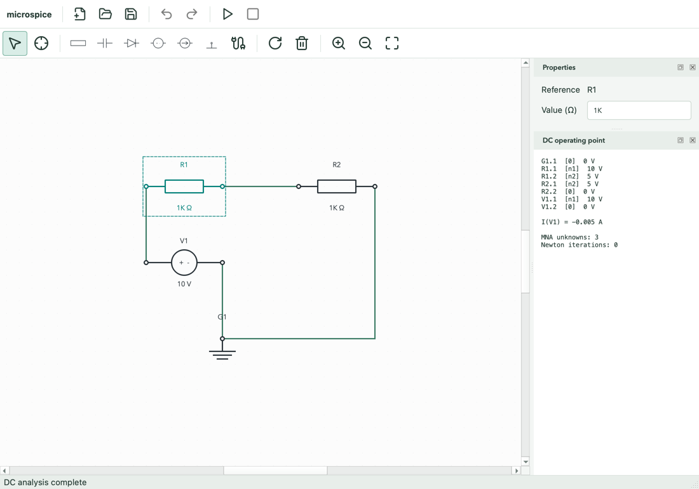
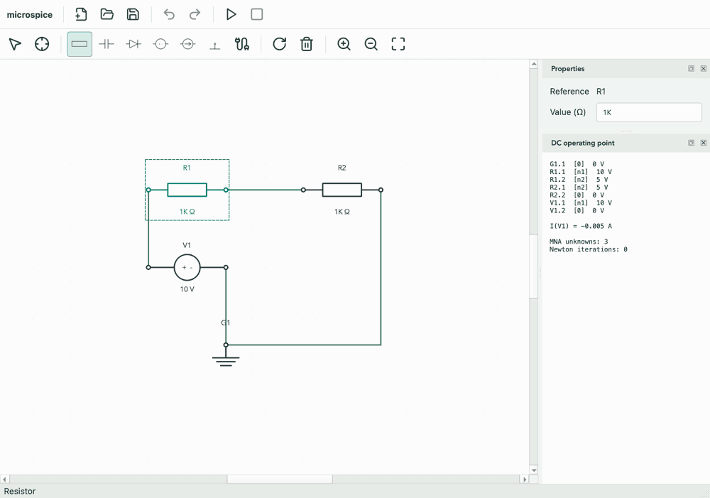
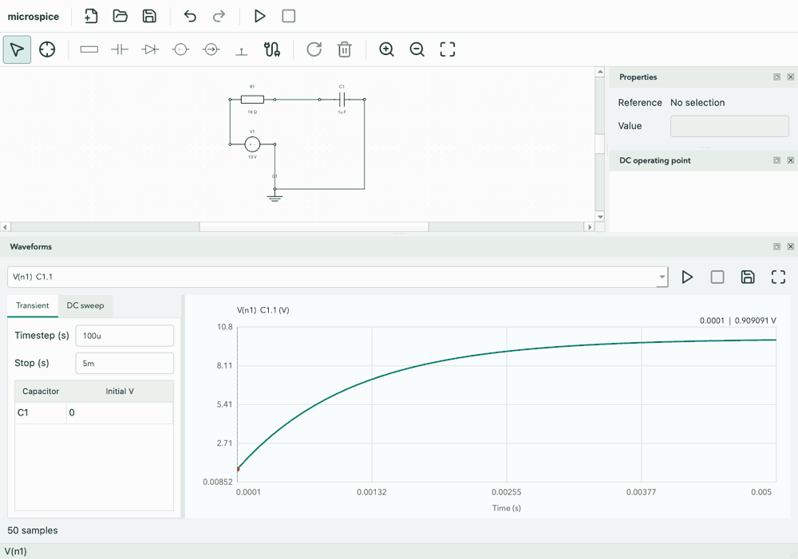
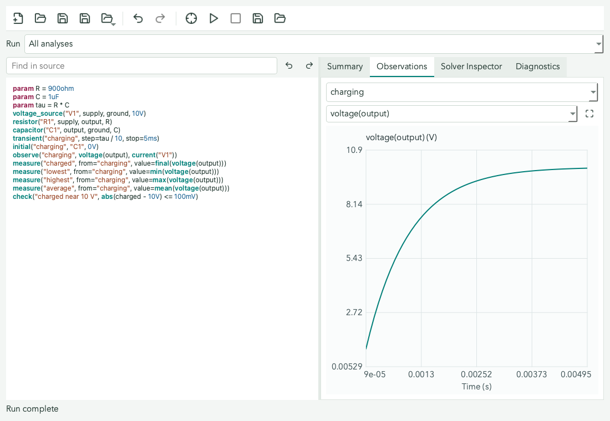
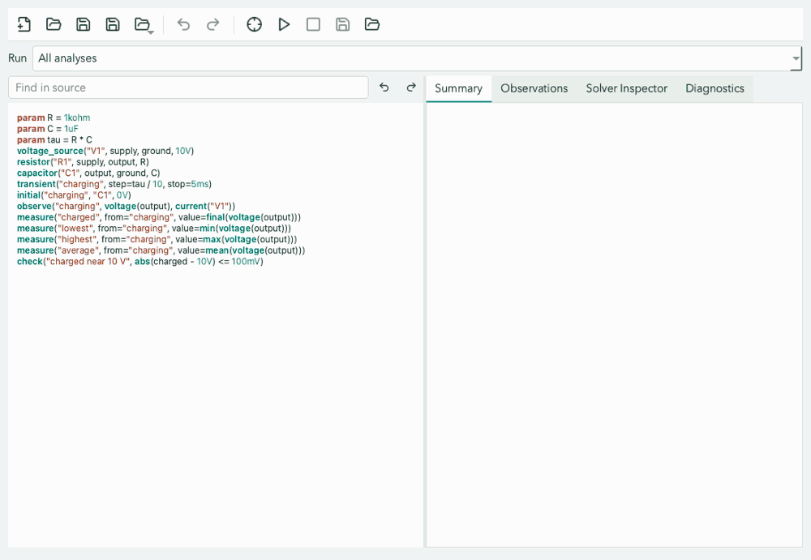
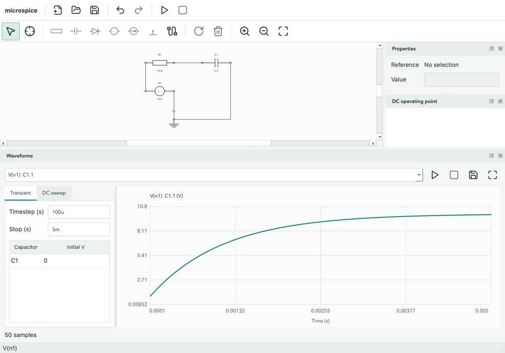
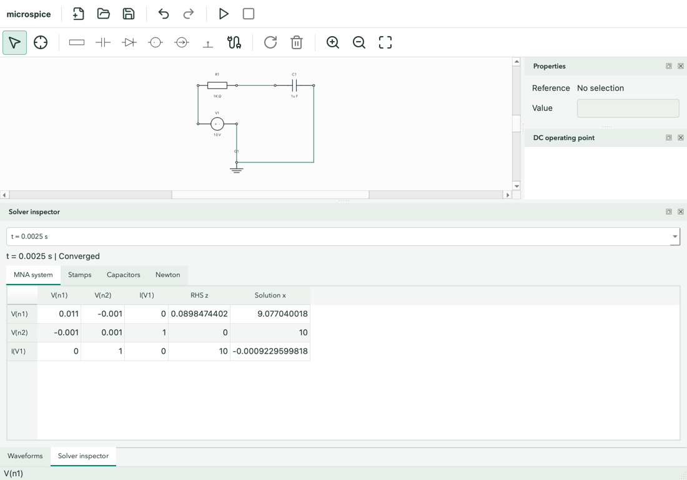

# microspice

> A SPICE-inspired circuit simulator built from first principles in modern C++.
> The goal is not only to compute voltages, but to make every equation, matrix
> stamp, and numerical decision visible.

[](../../actions/workflows/ci.yml)


## Current Capabilities

microspice solves linear and nonlinear DC circuits plus linear capacitor
transients. The numerical core includes:

- a dense matrix type,
- Gaussian elimination with partial pivoting,
- a GUI-independent circuit model,
- Modified Nodal Analysis (MNA) with inspectable component stamps,
- ideal voltage sources and their solved branch currents,
- a strict SPICE-like netlist parser with line-numbered errors,
- engineering values such as `1k`, `4.7u`, and `2meg`,
- backward-Euler capacitor companion models,
- `.tran` analysis directives and CSV waveform export,
- configurable initial capacitor voltages,
- per-timestep matrix, right-hand side, and capacitor-history diagnostics,
- an RC walkthrough checked against the analytical charging curve,
- Shockley-equation diode models with configurable $I_S$ and ideality factor,
- Newton-Raphson tangent linearization and junction-voltage limiting,
- inspectable convergence diagnostics for every iteration,
- `.dc` source sweeps with CSV output,
- diode-curve, clipper, and half-wave rectifier examples,
- detection of floating or otherwise singular circuits,
- an inspectable result containing the full MNA system and solution,
- dependency-free tests derived from Ohm's law, and
- CLI tools for programmatic and text-netlist workflows.

The component set remains deliberately small so every model and convergence
decision stays testable and visible.

Phase 5 includes an optional Qt 6 Widgets desktop editor with component
placement, orthogonal wires, junctions, property editing, rotation, deletion,
grid snapping, zoom/pan, and linear/nonlinear DC analysis. Resistors,
capacitors, diodes, voltage/current sources, and ground symbols translate into
the same tested `Circuit` API. Versioned JSON project files, atomic saves,
undo/redo, connected component movement, transient and DC-sweep controls,
waveform plots, CSV export, interactive voltage/current probes, and a
matrix/Newton inspector are implemented. Qt stays outside the core.

Desktop examples, offline help, background cancellation, and the independent
`.msim` Script Workspace are implemented. Windows and macOS test packages pass
hosted deployment checks; public release compliance and signing remain separate.

An optional local browser Script Workspace uses the same C++ compiler and solvers
through a loopback-only Python service. It supports source files, examples,
diagnostics, named analyses, waveform inspection, samples, checks and CSV export.
It is not a WebAssembly build or a browser schematic editor.

## Browser Workspace

Requires CMake 3.20+, a C++17 compiler, and Python 3.9+. The optional JSON adapter
dependency (nlohmann/json 3.11.3, MIT) is fetched on the first configure; the core
and desktop builds do not gain that dependency.

```bash
cmake -S . -B build-web -DMS_BUILD_WEB=ON -DMS_BUILD_GUI=OFF
cmake --build build-web --parallel 4
ctest --test-dir build-web --output-on-failure
python3 web/server.py --port 8765
```

Open **http://127.0.0.1:8765**. For Windows or a multi-configuration generator,
pass `--bridge` with the built `microspice_web_bridge.exe` path. Use `--port` to
select an unused port. No Node.js, Qt, account, or CDN is required at runtime.
See the [web usage guide](docs/web-workspace.md) for document handling,
limitations, security boundaries, and deployment details. AC analysis is deferred
until after this browser milestone.

## GUI preview

The Qt desktop workspace: a wired voltage divider, component properties, and
its solved DC operating point.



### Connected editing

Drag R1 while the resistor placement tool remains active. Attached wires
reconnect on release, DC analysis reruns, and Undo restores the complete edit.



### Waveform inspection

A 50-sample RC charging trace, with the real plot cursor moving across time
and displaying the nearest sample's voltage.



### Script Workspace

Edit an RC circuit's resistance, validate the source, run its analysis and
inspect the charging waveform. Scripts remain independent of visual schematics.





<details>
<summary>More screenshots: waveform analysis and solver diagnostics</summary>

**Transient analysis** with engineering-value inputs and capacitor initial conditions.



**Solver inspector** showing a transient sample's labelled MNA matrix, right-hand
side, and solution.



</details>

These are captures of the running macOS application, not mockups. The GIFs use
scripted GUI interactions with playback timing chosen for readability.
[Capture and regeneration instructions](docs/images/README.md) are included.

## Quick start

### Microspice Script

A new Qt-free `.msim` language provides function-call circuit descriptions,
unit-checked parameters, reusable subcircuits, named DC/transient/sweep analyses,
measurements, and pass/fail checks. Existing SPICE `.cir` parsing is unchanged.

```bash
cmake -S . -B build
cmake --build build
./build/microspice_script check examples/scripts/voltage_divider.msim
./build/microspice_script run examples/scripts/rc_charging.msim
```

See the [language guide](docs/simulation-language.md) for syntax, units,
subcircuits, CSV export, limitations and all six runnable examples.
In the desktop app, **Tools > Script Workspace** opens a separate editor with
syntax highlighting, source diagnostics, Compile/Run/Cancel, named analyses,
waveforms, solver inspection, and CSV export. Scripts and visual schematics
have independent save/undo/unsaved-change handling; neither replaces the other.

### SPICE Netlists and Core Walkthroughs

```bash
cmake -S . -B build
cmake --build build
ctest --test-dir build --output-on-failure
./build/dc_walkthrough
./build/transient_walkthrough
./build/nonlinear_walkthrough
./build/microspice_cli examples/voltage_divider.cir
./build/microspice_cli examples/rc_charging.cir > rc.csv
./build/microspice_cli examples/diode_curve.cir > diode.csv
./build/microspice_cli examples/diode_clipper.cir > clipper.csv
./build/microspice_cli examples/half_wave_rectifier.cir > rectifier.csv
```

### Desktop editor

Install Qt 6.2 or newer with its Widgets module, then configure the optional
GUI target. Set `CMAKE_PREFIX_PATH` to your Qt installation prefix if CMake
cannot discover it automatically:

```bash
cmake -S . -B build-gui -DMS_BUILD_GUI=ON -DCMAKE_PREFIX_PATH="$HOME/Qt/6.8.3/macos"
cmake --build build-gui
ctest --test-dir build-gui --output-on-failure
./build-gui/gui/microspice_gui
```

On macOS the executable is built inside an app bundle. Launch it with
`open build-gui/gui/microspice_gui.app` instead of the executable command above.

The editor opens a wired 10 V divider. Run DC (the play icon or F5) to see
the 5 V midpoint, terminal voltages, source currents, and iteration count.

### Starter schematics

Use **File > Examples** to open a pre-wired circuit, like Arduino's starter
sketches. Examples are bundled into the app and work offline, including in
portable packages. Each opens as an editable, unsaved copy: Save asks for a new
filename and never overwrites the bundled example. Opening an example asks you
to Save, Discard, or Cancel if the current project has unsaved changes.

| Example | What to try | Expected result |
| --- | --- | --- |
| [Ohm's law - resistor load](examples/resistor_load.microspice) | Run DC; change R1 | 5 V across 1 KΩ, giving 5 mA |
| [Voltage divider](examples/voltage_divider.microspice) | Run DC; change the resistor ratio | 10 V divided to a 5 V midpoint |
| [Current-driven resistor](examples/current_driven_resistor.microspice) | Run DC; change I1 or R1 | 2 mA through 1 KΩ gives 2 V |
| [RC charging](examples/rc_charging.microspice) | Run the prepared transient; probe C1 | 1 ms time constant; charging toward 10 V |
| [Diode bias](examples/diode_bias.microspice) | Run DC; open Solver Inspector | Roughly 0.57 V forward bias with nonlinear convergence |

RC charging opens the waveform panel with a `100u` timestep and `5m` stop time;
the other examples are ready for Run DC. For diode bias, a V1 sweep from 0 to
5 V in 0.1 V steps also shows its nonlinear response. No analysis runs implicitly
when you open an example.

The catalog uses the current resistor/capacitor/diode/independent-source models.
Op-amp, transistor, 555-timer, and AC-source examples need additional device
models or analysis support and are not included yet.

### Canvas editing

- Choose a component symbol in the toolbar, then click to place it on the
      20-unit grid. Tools remain active until another tool is selected.
- Choose Select to drag, select, or rubber-band components and wires. Rotate
      turns selected components by 90 degrees; Delete removes the selection.
- Select one component to edit its value, including suffixes such as `2.2k`
      and `4.7u`. Diodes expose saturation current and ideality factor. Sources
      accept positive, zero, or negative values.
      Component labels and the value field use engineering prefixes: `10000`
      displays as `10K`, `1000000` as `1M`, `0.001` as `1m`, and `0.000001`
      as `1u`. GUI input distinguishes uppercase `M` (million) from lowercase
      `m` (milli); `meg` is also accepted. Netlist/CLI parsing keeps the SPICE
      convention: `meg` means million and either `m` or `M` means milli.
- Choose Wire and click its start and end. The preview follows a horizontal,
      then vertical path. Escape or right-click cancels an unfinished wire.
- Wire endpoints on another wire create junctions; interior-only crossings
      remain unconnected. Terminals touching a wire connect to it. Junction dots
      mark branching wire connections. All ground symbols share node `0`.
- Scroll to zoom around the pointer; hold the middle mouse button to pan.
- File provides New, Open, Save, and Save As with the platform's standard
      shortcuts. Project files use the `.microspice` extension and contain JSON.
      Try [the saved divider](examples/voltage_divider.microspice).
- Edit provides Undo and Redo. Placement, properties, movement, rotation,
      deletion, and wire creation are undoable. A complete drag or two-segment
      wire gesture is one undo step. History keeps the most recent 100 edits.
- New, Open, and window close offer Save, Discard, or Cancel when there are
      unsaved edits. Failed or cancelled saves leave the document open and dirty.

Attached wire endpoints reroute on completion of a component move or rotation.
Shared or interior junctions stay anchored and receive a connecting lead.
Routing uses simple orthogonal bends, not obstacle avoidance; inspect new bends
near other wires because endpoint touches still create junctions. Undo restores
both the component and its previous wiring. Every real edit invalidates the
displayed DC results. Floating or singular circuits and missing ground are
reported in the results panel. Capacitors are open circuits in DC.

### Waveform analysis

Use Analysis > Transient or Analysis > DC Sweep to open the waveform dock.
The dock's play icon runs the selected analysis; F5 still runs a DC operating
point. Inputs accept engineering suffixes such as `100u`, `5m`, and `0.1`.

- Transient uses timestep and stop time in seconds, plus an initial voltage
      for each capacitor. Open [the RC project](examples/rc_charging.microspice)
      and run the default `100u` timestep and `5m` stop time to see charging
      toward 10 V. Initial voltages default to zero.
- DC sweep selects an ideal voltage source and start, stop, and step voltages.
      Descending sweeps use a negative step. Diodes use the core nonlinear solver.
- The trace menu selects a node voltage or voltage-source current; terminal
      references identify voltage traces. Each trace has its own vertical scale.
      Scroll over the plot to zoom horizontally, drag to pan, hover for a sample
      readout, and use the reset icon to restore the full range.
- The save icon exports CSV atomically. Transient CSV uses the core's time and
      node-voltage columns; sweep CSV includes voltages, source currents, and
      convergence diagnostics. Edits to the schematic or analysis settings clear
      the plot and disable export until a successful rerun.

Transient analysis remains linear-only: diode transients are rejected.
Backward-Euler samples start at the first timestep, not at time zero, and the
last sample is the greatest timestep multiple not beyond the stop time.
Analysis settings and results are session-local and are not saved in project
files. Opening a different project resets initial capacitor voltages.
DC, transient, and sweep runs execute on background workers. The stop icon next
to Run DC cancels DC analysis; the waveform dock has its own stop icon and sample
progress indicator. Only one analysis runs at a time. Editing the circuit or
waveform settings cancels the affected run and discards its pending result.
Workers use circuit/settings snapshots and publish only on the UI thread.

Cancellation is cooperative at matrix pivots, Newton iterations, timesteps, and
sweep points. Closing the window cancels and waits for active work; it may briefly
wait for the next cancellation checkpoint. Extraction and final UI display still
run on the UI thread. Waveform runs remain limited to 2000 samples and a
conservative diagnostic-size budget; large analyses should use the CLI.

### Probes and solver inspector

Choose Probe in the schematic toolbar. Click a terminal or wire to select its
voltage waveform, or a voltage-source body to select its branch-current waveform.
Ground has a zero-volt trace. After Run DC, probes also display operating-point
readings on the schematic. Probing does not modify the project or undo history.
At an interior-only crossing, one wire is chosen without joining the nets;
click a segment away from the crossing to choose the intended wire explicitly.

Analysis > Solver Inspector opens diagnostics for the latest successful analysis
or the last nonconverged DC attempt. Its frame selector chooses a transient sample
or sweep point. Tabs show the labelled MNA matrix, RHS and solution, component
stamp operations, capacitor companion/history values, and Newton convergence.
Selecting a Newton iteration displays each diode's linearization voltage,
solved voltage, current, conductance, and equivalent current.

The Newton matrix is the final assembled linearized system, not a separate matrix
for every iteration. Transient stamps show static devices; capacitor companions
are listed separately. Circuit edits clear diagnostics and DC probe readings;
waveform-setting edits clear their associated results. Diagnostics and probes
are session-local. Failed sweeps currently report an error rather than retaining
partial sweep diagnostics.

Project files preserve references, positions, rotations, values, diode
parameters, wires, and reference counters. Files are validated before replacing
the scene, and `QSaveFile` commits saves atomically. See
[Phase 5: Desktop Projects and Editing](docs/phase-5-desktop-editor.md) for
the schema, history design, and validation limits.

### Desktop workspace

**Help > User Guide** (F1) opens the complete bundled
[desktop user guide](docs/user-guide.md), with topic navigation and forward/backward
text search. It works offline in both development and portable builds. Help also
provides About microspice and About Qt.

The desktop workspace separates project commands from schematic tools, with
consistent high-DPI action icons and selection-aware edit controls. Invalid
component values remain editable with inline feedback rather than a modal dialog.
The fitted canvas adapts to window resizing until you manually zoom or pan.
The View menu exposes all panels and resets their layout; normal app sessions
remember window geometry and panel layout, while smoke tests use isolated defaults.
Lucide icon attribution is bundled with the other package notices.

### macOS packaging

With the GUI configured and built, install a self-contained app and create a ZIP:

```bash
cmake --install build-gui --prefix "$PWD/build-gui/package" --component Desktop
cmake -DBUNDLE="$PWD/build-gui/package/microspice_gui.app" -P gui/verify_macos.cmake
cpack --config build-gui/CPackConfig.cmake -B build-gui/releases
open build-gui/package/microspice_gui.app
```

Installation uses the Qt SDK's `macdeployqt` to bundle frameworks and native
plugins, then ad-hoc signs the app. The app includes an icon, project-version
metadata, and divider/RC sample projects under `Contents/Resources/examples`.
The verification script checks signatures, rejects development-machine dependency
paths, and runs the native full-window smoke test. Run it from a writable directory
because the smoke test writes screenshots there. A display session is required.

The ZIP contains the app, which can be moved into Applications. Builds target the
configured architecture and macOS deployment target; this is not a universal build.
Ad-hoc signing is local integrity signing, not Developer ID signing or notarization.
Downloaded copies may be blocked by Gatekeeper. Public releases still need signing,
notarization, testing on other Macs, and review of Qt/third-party redistribution
licenses and required notices. Linux GUI packaging is not provided yet.

### Windows packaging

Use an x64 MSVC developer terminal with Qt installed and discoverable by CMake:

```powershell
cmake -S . -B build-gui -G Ninja -DMS_BUILD_GUI=ON -DCMAKE_BUILD_TYPE=RelWithDebInfo
cmake --build build-gui --parallel 4
cmake --install build-gui --prefix "$PWD/build-gui/package" --component Desktop
./gui/verify_windows.ps1 -Package build-gui/package -OutputDirectory build-gui/windows-smoke
cpack --config build-gui/CPackConfig.cmake -B build-gui/releases
```

Extract the entire ZIP into a folder and launch `microspice_gui.exe`. Keep the
DLLs and plugin directories alongside it. Example projects are under `examples`.
`windeployqt` bundles Qt dependencies; CMake supplies MSVC/UCRT runtime libraries.
The executable includes an icon and version metadata and opens without a console.
This portable package is not an installer and does not register file associations.
It is unsigned, so SmartScreen may warn. Public distribution still requires
license-notice review and testing on supported clean Windows installations.

The verification script removes Qt environment overrides and SDK paths from
`PATH`, then runs a native smoke test with a timeout. CI also verifies the ZIP
extracted into a path with spaces. This checks Qt SDK independence, not every
possible dependency on system libraries already installed on a hosted runner.

Both desktop packages now include a versioned Qt provenance note, the build SDK's
SPDX documents, and LGPLv3/GPLv3 companion texts under `notices` (inside
`Contents/Resources` on macOS). Package verification requires these materials.
They do not complete a third-party license audit. microspice has no declared
project license yet, which also blocks public redistribution. See the
[release-readiness checklist](docs/release-readiness.md) for licensing, matching
dependency sources, clean-machine acceptance, signing and publication gates.

On this development Mac, Qt is installed at `$HOME/Library/Qt/6.8.3/macos`.
CMake is available at `/usr/local/Cellar/cmake/3.31.6/bin/cmake` (not currently
on PATH). Qt 6.8.3 references the legacy AGL framework, so builds with an SDK
that has removed AGL need an older installed SDK or a newer compatible Qt.
The verified local configuration uses:

```bash
/usr/local/Cellar/cmake/3.31.6/bin/cmake -S . -B build-gui \
      -DMS_BUILD_GUI=ON \
      -DCMAKE_PREFIX_PATH="$HOME/Library/Qt/6.8.3/macos" \
      -DCMAKE_OSX_SYSROOT=/Library/Developer/CommandLineTools/SDKs/MacOSX15.2.sdk
/usr/local/Cellar/cmake/3.31.6/bin/cmake --build build-gui
/usr/local/Cellar/cmake/3.31.6/bin/ctest --test-dir build-gui --output-on-failure
```

### Continuous integration

The CI workflow builds the Qt-free core on Linux (GCC and Clang), macOS
(Apple Clang), and Windows (MSVC). A separate Qt 6.10.0 desktop matrix builds
the GUI and runs all tests on Ubuntu 24.04, macOS 14, and Windows Server 2022.
GUI tests use the offscreen plugin; the macOS job also deploys the app, verifies
its bundle signature and dependency paths, and runs its native smoke test.

Runs trigger on pull requests, pushes to `main`/`master`, or manual dispatch
from GitHub Actions. Desktop test logs and screenshots are retained as artifacts
for 14 days, including when tests fail. Successful macOS and Windows jobs upload
test ZIPs, not signed/notarized public releases. Windows checks staged and extracted
packages without Qt SDK paths. Linux packaging remains future work.
Hosted-platform results are only known after a
workflow run; local macOS checks cannot establish Windows/Linux compatibility.
The formatting job uses clang-format 18 with the repository's configuration.

With `MS_BUILD_GUI=OFF` (the default), Qt is not required. GUI tests use Qt's
offscreen platform and check selection, grid snapping, value validation,
zoom bounds, pointer anchoring, nonblank rendering, mouse-driven placement
and wiring, junction extraction, rotation, deletion, and result invalidation.
Project tests cover JSON roundtrips, the saved divider's 5 V result, malformed
files, failed saves, unsaved-change decisions, undo/redo, gesture grouping,
connected movement, and close cancellation.
Waveform tests check RC charging against backward Euler, initial conditions,
linear and diode sweeps, negative sweep steps, core CSV output, plot rendering,
zoom/pan, trace selection, single-point ranges, invalidation, and input limits.
A full-window smoke test solves the divider, edits an engineering value,
solves a diode circuit, checks missing-ground reporting, exercises undo/redo
and save/reopen, runs transient/sweep/export, and captures large and compact
window screenshots in the GUI build directory.
Probe tests cover real mouse clicks, unchanged history, ground, disconnected
crossings, junctions, trace selection, and edit invalidation. Inspector tests
check matrix labels and solutions, sample history, Newton/diode selection, and
nonconvergence display; adapters verify retained systems satisfy $Ax = z$.
Background tests cover worker/UI thread ownership, progress, cancellation,
completion races, exceptions, reuse, and teardown. Panel/window tests exercise
asynchronous DC/waveform completion, stop controls, busy-state coordination,
pending-result invalidation, and closing a panel during analysis.

The example constructs this network:

```text
             R1 = 1 kohm       R2 = 1 kohm
  1 mA --->  (in) ---/\/\/--- (out) ---/\/\/--- ground
```

The same current passes through both resistors, so a hand calculation gives:

```text
V(out) = 1 mA * 1 kohm = 1 V
V(in)  = 1 mA * 2 kohm = 2 V
```

The program then shows how the simulator reaches those values from a matrix.

The netlist CLI uses the more familiar voltage-divider example:

```text
* A 10 V source and two equal resistors produce 5 V at out.
V1 in 0 DC 10
R1 in out 1k
R2 out 0 1k
.end
```

It reports `V(in) = 10 V`, `V(out) = 5 V`, and `I(V1) = -5 mA`. Source current
is defined from the source's `+` node to its `-` node, so the negative value says
the source is delivering power to the resistors.

## The central equation

Kirchhoff's Current Law says that currents at every node must balance. For
linear DC circuits, collecting one equation per non-ground node produces:

```text
G * v = i
```

- `G` is the conductance matrix.
- `v` is the vector of unknown node voltages.
- `i` is the vector of current injected into each node.
- Ground is known to be 0 V, so it is not an unknown or matrix row.

A resistor with resistance `R` has conductance `g = 1/R`. Between nodes `a`
and `b`, it stamps:

```text
G[a][a] += g
G[b][b] += g
G[a][b] -= g
G[b][a] -= g
```

Terms involving ground are omitted because ground has no matrix row. A current
source whose arrow runs from `a` to `b` removes current from `a` and injects it
into `b`:

```text
i[a] -= I
i[b] += I
```

See [Phase 1: From KCL to Code](docs/phase-1-dc-analysis.md) for the complete
derivation and a worked matrix example.

## Why voltage sources require MNA

An ideal voltage source states a voltage directly but does not provide a
current-resistance relationship. Ordinary nodal analysis therefore has no way
to write its current in terms of node voltages. Modified Nodal Analysis adds one
unknown branch current and one voltage equation for each ideal source:

```text
A * x = z

x = [node voltages, voltage-source currents]
```

For `V1 in 0 10`, the added equation is `V(in) = 10`, and the added current
unknown participates in KCL at `in`. This turns the two-node divider into a
three-unknown system: `V(in)`, `V(out)`, and `I(V1)`.

See [Phase 2: MNA and Netlists](docs/phase-2-mna-netlists.md) for the augmented
matrix derivation, source stamp, parser grammar, suffix table, and sign
conventions.

## How a capacitor becomes a matrix stamp

A capacitor obeys $i=C\,dv/dt$. Backward Euler approximates the derivative over
one timestep and rearranges the result into a conductance plus a history source:

```text
G_eq      = C / dt
I_history = G_eq * V_previous
i_new     = G_eq * V_new - I_history
```

That companion model can be stamped into the same MNA system as the DC devices.
After each solve, the capacitor voltage becomes the history value for the next
step. See [Phase 3: Transient Analysis](docs/phase-3-transient-analysis.md) for
the derivation, RC example, accuracy discussion, and API details.

## How a diode becomes a linear iteration

A diode follows the nonlinear Shockley equation
$I_D=I_S(e^{V_D/(nV_T)}-1)$. Newton-Raphson replaces it at the current voltage
guess with a tangent conductance and equivalent current source:

```text
Gd  = dI/dV
Ieq = I(Vd) - Gd * Vd
```

The resulting linear MNA system produces the next voltage guess. Iteration
continues until both the complete solution and every diode junction agree with
their linearization points. Junction-voltage limiting keeps early guesses from
overflowing the exponential. See [Phase 4: Nonlinear DC
Analysis](docs/phase-4-nonlinear-dc.md) for the derivation, stamp, convergence
policy, and worked resistor-diode example.

## Library API

The simulation core does not depend on terminal or GUI code:

```cpp
#include "microspice/circuit.hpp"
#include "microspice/dc_solver.hpp"

microspice::Circuit circuit;
circuit.addVoltageSource("V1", "in", "0", 10.0);
circuit.addResistor("R1", "in", "out", 1e3);
circuit.addResistor("R2", "out", "0", 1e3);

const auto result = microspice::solveDc(circuit);
const double outputVoltage = result.voltage("out");
```

Transient analysis uses the same circuit:

```cpp
circuit.addCapacitor("C1", "out", "0", 1e-6);
const auto waveform = microspice::solveTransient(circuit, {1e-4, 5e-3, {}});
const double firstSample = waveform.voltage(0, "out");
```

Nonlinear DC analysis retains every Newton iteration:

```cpp
circuit.addDiode("D1", "out", "0");
const auto nonlinear = microspice::solveNonlinearDc(circuit);
const double diodeVoltage = nonlinear.operatingPoint.voltage("out");
```

`DcResult` also retains the assembled matrix, right-hand side, complete solution,
source-current names, and every stamp. That data is useful for tests today and
powers the desktop matrix inspector without coupling the solver to Qt. The
first browser workspace displays observations and measurements, not solver matrices.

## Architecture

```text
Qt schematic editor     Browser workspace      CLI tools
      |                  Python/JSON bridge         |
      |                         |                  |
      +-------------- Script compiler / netlist parser
                          |
                    public Circuit API
                          |
             circuit model + analyses
                          |
              matrix assembly + solver
```

The dependency direction always points toward the numerical core. A schematic
editor translates symbols and wires into a `Circuit`; neither UI contains
simulation equations. Scripts lower directly to the same circuit model.

## Development phases

### Phase 1 - Linear DC foundation (complete)

Dense solver, resistor/current-source stamps, traceable matrix assembly, CLI,
and hand-verifiable tests.

### Phase 2 - Netlists and voltage sources

Parse a small SPICE-like text format, support engineering suffixes (`1k`,
`10u`), and introduce Modified Nodal Analysis for ideal voltage sources.
**Complete.**

### Phase 3 - Time-domain simulation (complete)

Add capacitors, backward-Euler integration, transient analysis, CSV export, and
RC charging/discharging examples checked against analytical solutions.

### Phase 4 - Nonlinear devices (complete)

Add the Shockley diode equation, Newton-Raphson linearization, convergence
diagnostics, DC sweeps, diode curves, clippers, and rectifiers.

### Phase 5 - Desktop GUI and scripts (delivered)

Implemented: optional Qt Widgets target, component placement, schematic
canvas, properties, orthogonal wires, node extraction, rotation/deletion,
pan/zoom, linear/nonlinear DC controls and results, project save/load,
unsaved-change guards, undo/redo, connected movement, transient/sweep controls,
waveform plotting, CSV export, probes, matrix/Newton inspection, cancellable
background analysis, offline examples/help, macOS/Windows test packaging, and
an independent Script Workspace. The script compiler supports typed units,
parameters, subcircuits, measurements and checks through CLI and desktop.

### Browser Workspace (local implementation)

Script-based browser editor, shared C++ engine, local source open/download,
compile/run/stop, named analyses, diagnostics, waveform zoom/pan/cursor, sample
tables and CSV downloads. The local service is not a public multi-user host;
standalone WebAssembly, visual schematic editing, and matrix inspection are not
implemented in the browser.

### Next - AC analysis (deferred)

Implement linear complex-valued MNA, frequency sweeps and magnitude/phase
results after the browser workflow is stabilized. AC remains unsupported today.

### Phase 6 - Scale and performance

Introduce sparse storage, symbolic ordering, adaptive timesteps, additional
devices, benchmarks, and comparisons against established SPICE implementations.

## What this is not yet

This is not a replacement for production SPICE software. Phase 4 supports no
inductors, controlled sources, nonlinear transient analysis, adaptive
timesteps, temperature sweeps, or named semiconductor model cards. Those
limitations are explicit so each later feature arrives with its mathematics,
tests, and failure modes explained.